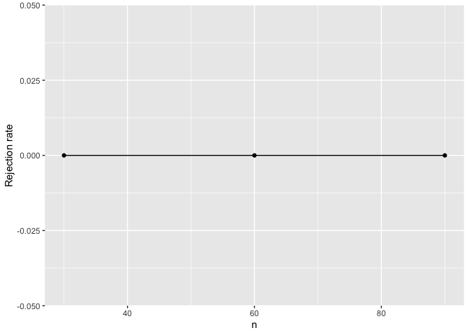

<!-- README.md is generated from README.Rmd. Please edit that file -->

# simttepower

<!-- badges: start -->

<!-- badges: end -->

simttepower is a companion to
[simtte](https://github.com/csetraynor/simtte) (\>= 1.1.0), providing
trial replication and simulation-based power and
operating-characteristic analysis on top of simtte’s single-cohort PK/PD
time-to-event simulator. Given a trial design and a grid of scenarios
that vary any one factor (a model parameter, a formula coefficient, a
dosing regimen, a sampling schedule, sample size, follow-up, or
covariate distribution), simttepower replicates each scenario, applies
one or more analysis functions to each simulated trial, and summarises
operating characteristics – power and type I error – across the grid. A
run can execute sequentially, across local worker processes, or split
into independent chunks for a job scheduler; all three give
byte-identical results for the same seed.

## Installation

simtte isn’t on CRAN yet, so install it first, then simttepower from
[GitHub](https://github.com/):

``` r
# install.packages("pak")
pak::pak("csetraynor/simtte")
pak::pak("csetraynor/simttepower")
```

## Example

Two arms of a built-in PK/PD hazard model, varying sample size on the
experimental arm, replicated, summarised, and plotted:

``` r
library(simttepower)

comparator <- arm(label = "comparator", n = 30, model = "irm1_hazard",
  end = 24, param = list(CL = 2, V2 = 20, KA = 1, KIN = 1, KOUT = 0.5,
    IC50 = 1, IMAX = 0.9, H0 = 0.15))
experimental <- arm(label = "experimental", n = 30, model = "irm1_hazard",
  end = 24, param = list(CL = 2, V2 = 20, KA = 1, KIN = 1, KOUT = 0.5,
    IC50 = 3, IMAX = 0.9, H0 = 0.15))

design <- trial_design(
  arms = list(comparator, experimental),
  analyses = list(coxph = analysis_coxph)
)

grid <- scenario_grid(design, over = list(arm = "experimental",
  field = "n", values = c(30, 60, 90)))

res <- power_sim(grid, n_sims = 8, seed = 1, progress = FALSE)
summary(res)
#> <simttepower_summary>
#>  scenario_id  n analysis n_sims reject_rate reject_se n_errors
#>           s1 30    coxph      8           0         0        0
#>           s2 60    coxph      8           0         0        0
#>           s3 90    coxph      8           0         0        0
#>  median_runtime_sec median_duration median_events_comparator
#>              0.0280              24                       29
#>              0.0380              24                       29
#>              0.0525              24                       30
#>  median_events_experimental
#>                        29.5
#>                        59.0
#>                        87.0
```

``` r
plot_power(summary(res), x = "n")
```



`power_sim(..., workers = 2)` dispatches across local worker processes
instead of running sequentially;
`power_sim_chunks()`/`power_sim_chunk()`/ `power_sim_merge()` split a
run into independent chunks for a job scheduler (SGE/Slurm templates
ship in `inst/templates/`). Both give byte-identical results to the
sequential run above – see `vignette("power-analysis")` for the full
walkthrough, a real dosing-regimen contrast, a covariate-adjusted
analysis, and a direction-aware rejection rule.

**Development note**: the `Remotes: csetraynor/simtte` entry in
`DESCRIPTION` (for installing simtte from GitHub pre-CRAN) is removed
before any CRAN submission.

You’ll still need to render `README.Rmd` regularly, to keep `README.md`
up-to-date. `devtools::build_readme()` is handy for this.
